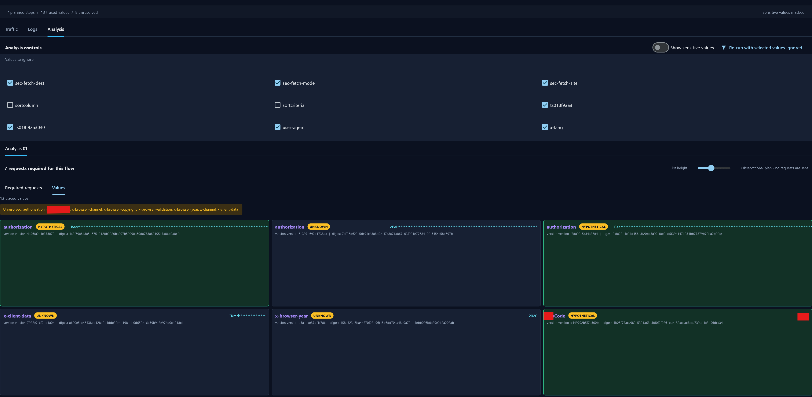
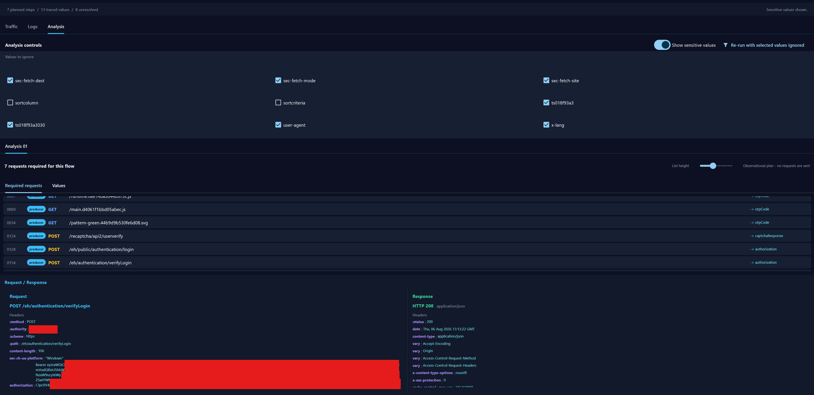

# Reqvexa

[](https://github.com/kareemheshaam/Reqvexa/actions/workflows/ci.yml)
[](https://www.python.org/)
[](LICENSE)
[](#development)

Browser traffic shows what happened. It usually does not show why a request
could work.

Reqvexa analyzes a HAR file, takes one request as the target, and traces the
cookies, tokens, headers, and other values that lead to it. The result is a
request flow with the evidence behind each relationship.

```text
Target: POST /api/products

Required state
├── session       <- POST /login
├── csrf_token    <- GET /csrf
├── access_token  <- POST /refresh
└── x-signature   <- unresolved client-side value
```

The project is currently an alpha release. It is focused on explaining
captured traffic, not generating a client or replaying requests.

## What It Does

- Reads HAR 1.2 captures while preserving request order, duplicate headers,
  response links, and raw fields.
- Extracts cookies, authorization headers, custom headers, query parameters,
  JSON/form values, and selected HTML state.
- Searches runtime values as text in earlier response bodies, headers, and
  cookies, independent of response MIME type, JSON shape, or origin.
- Handles URL-decoded, Base64/base64url, and `Bearer`-prefix representations.
- Tracks mutable values by temporal versions and records evidence/confidence.
- Expands prerequisite requests recursively and keeps unresolved values
  visible instead of guessing their source.
- Provides CLI output and an optional Flet desktop viewer with Traffic, Logs,
  and Analysis tabs.

## Why It Is Different

Most traffic tools focus on inspecting requests, exporting endpoints, or
replaying a flow. Reqvexa focuses on the state behind one request:

```text
request -> response -> value version -> request
```

Each value is shown with a status:

```text
SUPPORTED
producer: POST /login
evidence: exact value found in an earlier response

HYPOTHETICAL
source: not observed in the capture
evidence: request-side value with no matching earlier response
```

`SUPPORTED` means the value was found in an earlier captured response.
`HYPOTHETICAL` or `UNKNOWN` means the capture does not establish its source.
The tool does not turn a correlation into a claim that a value can be
regenerated.

## Screenshots

### Analysis view



### Required request flow



## Quick Start

Requires Python 3.12 or newer.

```text
python -m venv .venv
.venv\Scripts\activate
python -m pip install -e ".[dev,gui]"
reqvexa analyze fixtures/minimal.har.json
reqvexa trace fixtures/minimal.har.json --request REQUEST_ID
reqvexa plan fixtures/minimal.har.json --request REQUEST_ID
reqvexa report fixtures/minimal.har.json --request REQUEST_ID --format markdown
reqvexa gui fixtures/minimal.har.json
```

The request ID can be found with the `analyze` workflow or by loading the
capture in the GUI. Reports mask sensitive values by default. Use the
synthetic fixture first:

```text
Target:
GET https://reqvexa.local/api/products

State dependencies:
session       SUPPORTED
x-signature   UNKNOWN
```

## Example Output

For the included fixture, Reqvexa identifies the session value in an
earlier response and keeps the request signature unresolved:

```text
Target:
GET https://reqvexa.local/api/products

State dependencies:
session
status: SUPPORTED
producer: response from GET /

x-signature
status: UNKNOWN
note: No matching value was observed in prior responses.
```

The same information is available as a request plan:

```text
GET /
  produces: session

GET /api/products
  consumes: session, x-signature
  unresolved: x-signature
```

`SUPPORTED` means that a compatible value was found earlier in the capture.
`UNKNOWN` means the capture does not show where the value came from. It does
not mean that the value is invalid.

## Python API

```python
from reqvexa.capture import HarProvider
from reqvexa.provenance import ProvenanceEngine
from reqvexa.planning import plan_flow, safe_report

capture = HarProvider().load_file("capture.har")
target = capture.requests[-1]
analysis = ProvenanceEngine().analyze(
    capture,
    target_request_id=target.id,
)
plan = plan_flow(analysis, target.id)
report = safe_report(analysis, target.id)
```

The analysis reads the capture from disk and does not make network requests.

## Development

```text
python -m pytest -q
python -m compileall -q src tests
python -m ruff check src tests
python -m mypy src
```

The repository includes a deterministic benchmark:

```text
python -c "from tests.benchmark.runner import run_benchmark; print(run_benchmark())"
```

Current checks pass with 28 tests and 16 benchmark cases. The benchmark uses
synthetic traffic; `16/16 passing` is a regression result, not a claim about
accuracy on every real-world HAR.

HAR files can contain cookies, tokens, and other private data. Keep real
captures and generated reports out of commits. Use the included synthetic
fixtures for tests and examples.

## Project Status

Implemented:

- HAR parsing with preserved request order and header order.
- Value extraction from headers, cookies, query/form/JSON bodies, and
  selected HTML state.
- Raw-text matching in earlier responses, including URL/Base64/Bearer forms.
- Temporal versions, evidence-bearing provenance, and recursive flow plans.
- CLI and optional Flet GUI with live logs, analysis tabs, cancellation, and
  masked output.

Not included in this release:

- Request replay or generated API clients.
- Browser/Playwright capture.
- Automatic JavaScript execution or cryptographic signature reconstruction.

The first release is tagged `v0.1.0-alpha`.

## License

MIT.
